

<!-- Header SVG -->

### Extensión para navegador que mejora tu experiencia en **Nivel20**

Añade funcionalidades útiles para DMs y jugadores de D&D.

> **Aviso:** Esta extensión no es oficial ni está afiliada a Nivel20. Es un proyecto independiente de la comunidad.

## Instalación

### Desde las tiendas oficiales (recomendado)

- **Chrome Web Store**: [Instalar en Chrome](https://chromewebstore.google.com/detail/jadlpdmjlfghndcehdhjhgndfmigbdoe?utm_source=item-share-cb)
- **Firefox Add-ons**: [Instalar en Firefox](https://addons.mozilla.org/es-AR/firefox/addon/nivel21/)

### Instalación manual (ultimos cambios)

1. Descarga el archivo **n21ext.zip** de la [última version](https://github.com/androettop/nivel21/releases/latest), o [descárga los últimos cambios](https://github.com/androettop/nivel21/archive/refs/heads/master.zip) (puede ser inestable)
2. Abre tu navegador y ve a `chrome://extensions/` (Chrome) o `about:debugging#/runtime/this-firefox` (Firefox)
3. Activa el "Modo de desarrollador" (Chrome)
4. En chrome, haz clic en "Cargar extensión sin empaquetar" y selecciona la carpeta de la extensión, o en Firefox haz clic en "Cargar complemento temporal" y selecciona el archivo `manifest.json`
5. ¡Listo! La extensión está activa en Nivel20

### Actualización manual

1. Descarga el nuevo ZIP de la extensión (o actualiza tu copia local).
2. **Chrome**: ve a `chrome://extensions/` y presiona el icono de **Actualizar** en la extensión. Si no aparece, elimínala y vuelve a cargarla.
3. **Firefox**: ve a `about:debugging#/runtime/this-firefox` y presiona en el icono **Recargar** en la extensión. Si no aparece, elimínala y vuelve a cargar el `manifest.json`.

## Características

> **Aviso:** Estas características dependen del funcionamiento interno de Nivel20 y pueden dejar de funcionar con futuras actualizaciones.

### Tiradas con Ventaja/Desventaja

Modifica automáticamente tus tiradas de dados manteniendo presionadas las teclas especiales mientras haces clic en un botón de tirada.

- **Shift** - Tirada con Ventaja
- **Alt** - Tirada con Desventaja

<a id="advantage-disadvantage">
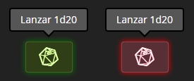
</a>

---

### Capas de Tokens

Sistema de capas para organizar y posicionar tokens en profundidad. Permite que los DMs asignen capas a los tokens para crear efectos visuales de profundidad y ordena automáticamente la visualización en z-order.

- **Click derecho en token (DM)** - Menú "Capa"
- **Seleccionar capa** - El token se posiciona según la capa asignada
- **Capas predefinidas** Fondo, Capa 1, Capa 2, Capa 3, Capa 4, Capa 5

<a id="token-layers">
 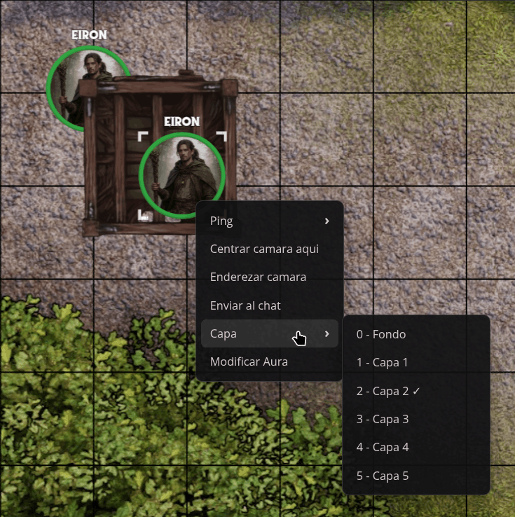
</a>

---

### Auras de Token

Asigna un aura de color alrededor de un token para representar zonas de efecto, rangos de hechizos, terreno difícil, trampas o estados.

- **Click derecho en token (DM)** - Opción "Modificar Aura"
- **Forma** - Círculo, Rectángulo, Cono o Línea
- **Color** - Blanco, Negro, Rojo, Verde, Azul, Amarillo, Naranja o Púrpura
- **Tamaño** - Radio, ancho/alto o longitud en casillas (admite decimales); los conos tienen apertura y los conos y líneas, dirección
- **Solo aura** - Oculta el token a los jugadores y deja ver solo el área (el DM lo ve semitransparente): ideal para marcar zonas con un token
- Las auras no se ven sobre tokens que el jugador no puede ver

<a id="token-aura">
 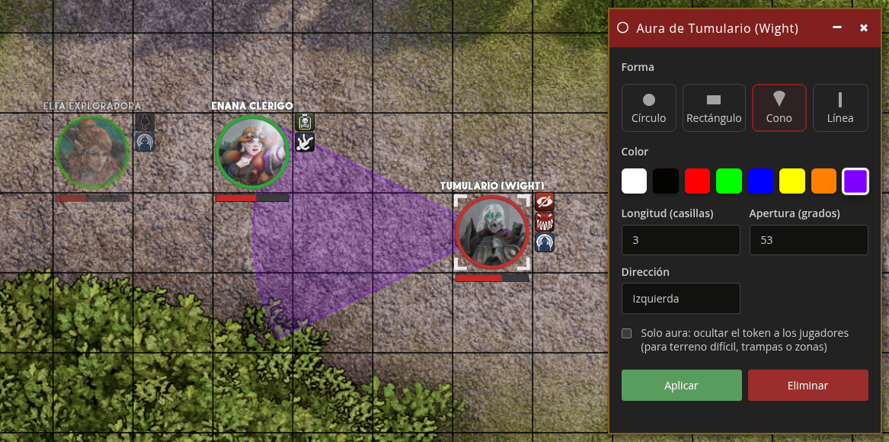
</a>

---

### Asignar Tokens a Jugadores

Asigna un token a un jugador para que solo ese jugador pueda controlarlo. El resto de jugadores no podrá seleccionarlo ni moverlo.

- **Click derecho en token (DM)** - Opción "Asignar a jugador" con la lista de jugadores conectados

Tanto el DM como los jugadores deben tener la extensión instalada. Los jugadores sin la extensión seguirán controlando con normalidad todos los tokens no bloqueados

<a id="token-assign-player">
 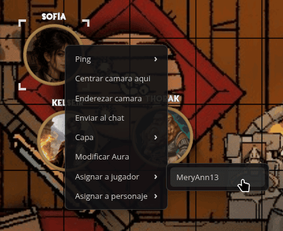
</a>

---

### Asignar Tokens a Personajes

Asigna un token a un personaje o criatura del panel de personajes. Al cliquear el token se selecciona automáticamente ese personaje/criatura, permitiéndote usar sus acciones más fácilmente.

- **Click derecho en token (DM)** - Opción "Asignar a personaje" con la lista de personajes y criaturas. Los grupos de criaturas ("3 x Goblin") aparecen por separado ("Goblin 1", "Goblin 2"…), para asignar cada token a una criatura concreta
- **Vinculación automática** - Los tokens añadidos desde la carpeta de personajes de la campaña quedan vinculados a su personaje sin hacer nada

Tanto el DM como los jugadores deben tener la extensión instalada. Los jugadores sin la extensión no podrán seleccionar automáticamente su personaje al cliquear el token

<a id="token-assign-character">
 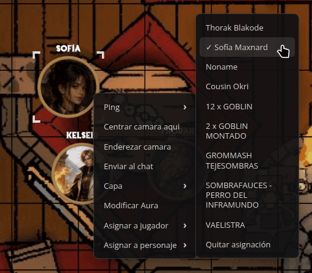
</a>

---

### Orden de Turnos

Lleva el orden de iniciativa del combate en un panel siempre a mano. El DM arma la lista y avanza los turnos, y todos los jugadores ven en tiempo real de quién es el turno.

- **Click derecho en token (DM)** - "Agregar turno" para sumar uno o varios tokens
- **Iniciativa automática** - Si el token está asignado a un personaje, su iniciativa se completa sola (antes debes tirar iniciativa normalmente para que se registre el valor)
- **Leer iniciativas (DM)** - El botón del dado toma de cada personaje su última tirada de "Iniciativa" del chat y tira la de las criaturas, y ordena la lista
- **Botón en el menú lateral** - Vuelve a abrir el panel cuando quieras, por si se cierra
- **Tus tokens resaltados** - A cada jugador se le marcan sus propios tokens
- **Resaltar en el mapa** - Pasa el mouse por una fila para ver de qué token se trata, marcado en el mapa. Haz click en la fila para centrar tu cámara en ese token (solo tu cámara)
- **Temporizador por turno (opcional)** - El DM define los segundos por turno; todos ven la cuenta regresiva, que se reinicia al cambiar de turno y continúa donde iba si recargas la página. Al llegar a 0 solo se pone en rojo

<a id="turn-order">
 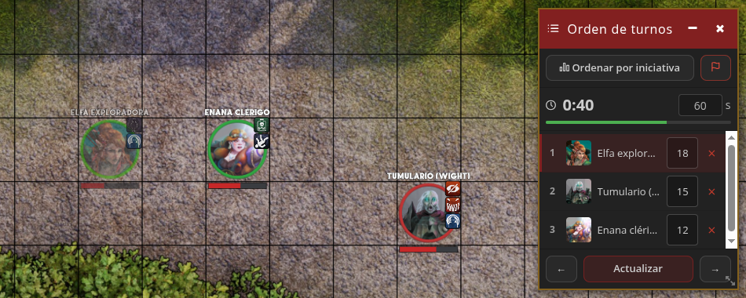
</a>

---

### Marco de personaje

Muestra en la esquina superior izquierda del tablero al personaje o criatura seleccionado (la misma lógica para el DM y los jugadores). Al entrar, el jugador ve directamente su propio personaje. En un grupo de criaturas se muestra la del token seleccionado.

- **Retrato** - Abre la hoja del personaje
- **Vida y CA** - Click en la vida para curar, dañar o dar puntos temporales. Si tiene el estado Concentración y recibe daño, ofrece tirar la salvación de Constitución con la CD correcta
- **Recursos** - Espacios de conjuro (con su número romano) y recursos con icono propio (Furia, Canalizar divinidad, Puntos de ki, Acciones legendarias…). Click gasta, click derecho recupera
- **Estados** - Click derecho quita un estado; el botón **+** permite buscar y agregar uno

Las ediciones solo están disponibles si tienes permiso para editar la vida de ese personaje en Nivel20, y se guardan con un pequeño retraso para no saturar el servidor si haces muchos clicks.

<a id="character-frame">
 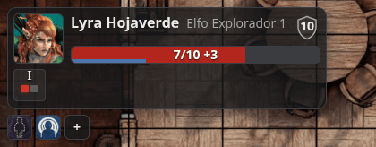
</a>

<a id="character-frame-hp">
 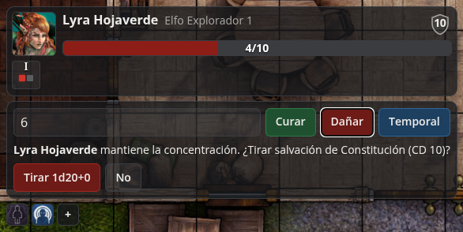
</a>

---

### Recursos de criaturas

Las criaturas no tienen recursos en Nivel20: el DM puede crearles casillas propias (conjuros por nivel, acciones legendarias, usos de rasgos…) desde **Recursos de criaturas** en el menú lateral o con click derecho en un token asignado. Se guardan en el navegador del DM y también se muestran en el marco de personaje.

<a id="creature-resources">
 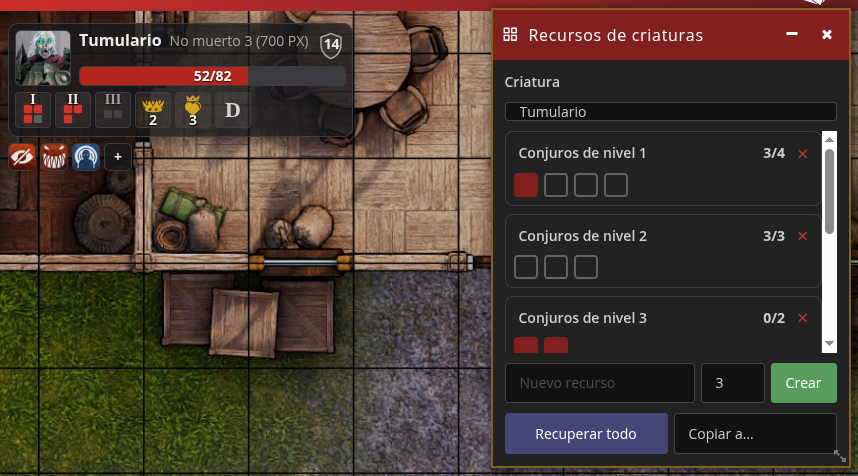
</a>

---

### Puntos de golpe y estados en los tokens

Los tokens asignados a un personaje o criatura muestran sus puntos de golpe («actual/máximo», en chico abajo dentro del token) y los iconos de sus estados sobre el borde derecho. Cada jugador solo los ve en los personajes y criaturas que puede ver en su panel (el DM los ve todos).

Si el personaje o criatura tiene el estado **Invisible**, su token se oculta a quienes no lo ven en su panel; quienes sí lo ven, lo ven semitransparente. No se cambia nada en Nivel20: sin la extensión, todos siguen viendo el token.

<a id="token-status">
 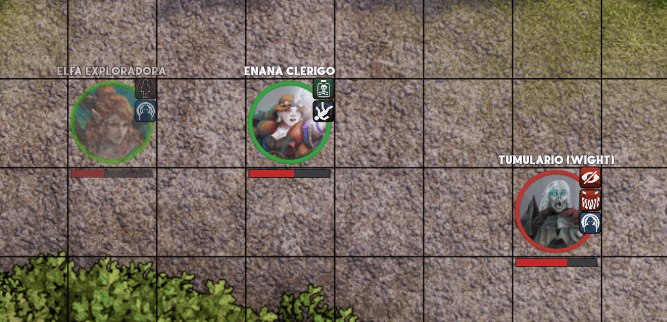
</a>

---

### Editor de la barra de acciones

En la página **Editar acciones** del personaje reemplaza la lista del formulario por un árbol:

- **Arrastrar y soltar** - Ordena las acciones o suéltalas en el centro de una carpeta para meterlas dentro, con carpetas en varios niveles
- **Icono y nombre** - Click en el icono para cambiarlo y en el nombre para renombrar
- **Carpetas de Nivel21** - Conjuros, Acciones, Rasgos e Inventario se pueden reordenar y ocultar
- **Acciones por defecto** - Pruebas de habilidad y Tiradas de salvación se pueden ocultar

Se guarda en el mismo formulario de Nivel20 al pulsar «Actualizar Personaje». El orden de lo que Nivel20 no guarda (carpetas de Nivel21) queda por personaje en tu navegador.

<a id="action-bar-editor">
 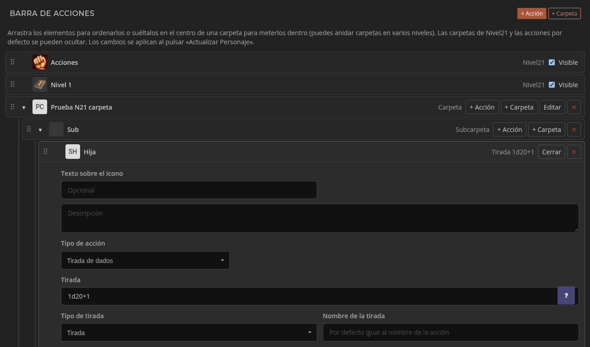
</a>

---

### Mediciones Persistentes

Mantén tus mediciones en el mapa de forma persistente. Usa el botón de anclaje en el panel de mediciones para activar o desactivar este modo.

- **Botón Toggle** - Activa/desactiva la persistencia de mediciones

<a id="multi-measurement">
 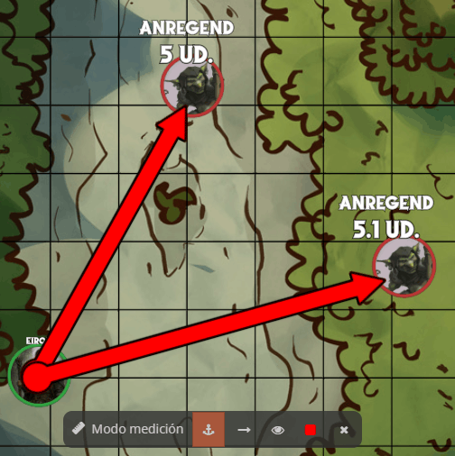
</a>

---

### Compartir Contenido al Chat

Comparte rápidamente conjuros, items, reglas y otros contenidos con tu DM y compañeros. Los elementos se resaltan en azul cuando están listos para compartir.

- **Shift + Click** - Comparte el elemento al chat

<a id="send-to-chat">
 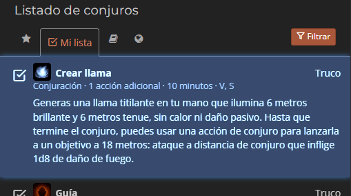
</a>

---

### Enlaces en Mensajes del Chat

Los enlaces de reglas, objetos, conjuros y otros contenidos de Nivel20 se detectan automáticamente en el chat y se abren en ventanas internas.

- **Auto** - Los enlaces se convierten automáticamente al escribirlos

<a id="parse-chat-links">
 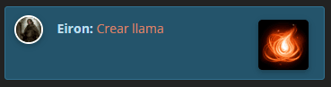
</a>

---

### Susurrar en el Chat

Envía mensajes privados a otros jugadores escribiendo `/w nombre`. El modo se cambia automáticamente a privado y solo el destinatario verá el mensaje. Los susurros se destacan en verde en el chat.

Los usuarios sin la extensión no podran recibir susurros.

- **/w nombre mensaje** - Enviar susurro privado
- **Tab** - Autocompletar nombre de usuario conectado (cicla entre coincidencias)

Ejemplos:

- **/w Lucius hola, ¿estás listo?**
- **/w "Ana María" ¿puedes revisar la pista?**

**Autocompletado con Tab:**

- Escribe `/w` y presiona Tab para ciclar entre todos los usuarios conectados
- Escribe `/w Lu` y presiona Tab para autocompletar usuarios que comienzan con "Lu"
- Presiona Tab varias veces para ciclar entre todas las coincidencias
- Las comillas se agregan automáticamente para nombres con espacios

<a id="whisper-mode">
 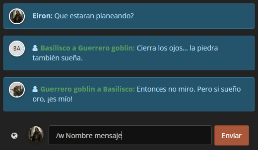
</a>

---

### Visibilidad de Tiradas de Dados

Controla quién ve tus tiradas de dados de forma independiente a la visibilidad del chat. Por ejemplo, puedes dejar los mensajes del chat en público pero que todas tus tiradas las veas solo tú.

Agrega un selector a la izquierda del campo de tiradas, igual al selector de visibilidad del chat.

- **Auto (según el chat)** - No cambia nada; usa la visibilidad configurada en el chat (comportamiento por defecto)
- **Todo el mundo** - Las tiradas las ve todo el mundo
- **Master y remitente** - Las ven el master y el remitente
- **Solo remitente** - Las ves solo tú
- **Nadie** - No las ve nadie

<a id="dice-visibility">
 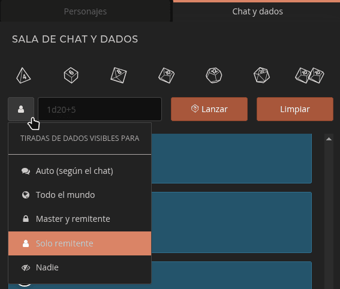
</a>

---

### Atajos para Tokens

Controla rápidamente los tokens/fichas del mapa usando atajos de teclado. Selecciona un token primero para activar estos atajos:

| Tecla        | Acción                         |
| ------------ | ------------------------------ |
| **Ctrl + H** | Alternar visibilidad del token |
| **Ctrl + B** | Bloquear/desbloquear el token  |
| **Ctrl + E** | Editar el token seleccionado   |
| **Ctrl + D** | Duplicar el token seleccionado |
| **Delete**   | Eliminar el token seleccionado |

<a id="token-hotkeys">
 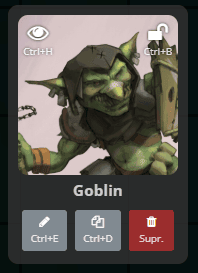
</a>

---

### Mover Tokens con el Teclado

Permite mover uno o varios tokens seleccionados con las flechas del teclado.

| Tecla       | Accion                  |
| ----------- | ----------------------- |
| **Flechas** | Mover token una casilla |

<a id="token-move-arrows">
 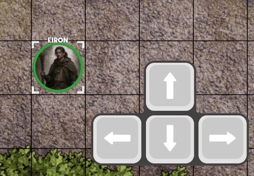
</a>

---

### Distancia recorrida

Muestra automáticamente la distancia recorrida al arrastrar tokens por el mapa.

<a id="token-drag-measurement">
 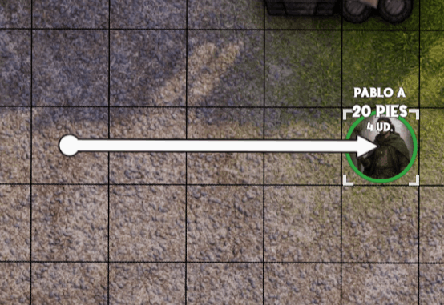
</a>

---

### Velocidad de arrastre de tokens

Incrementa la velocidad de las animaciones al arrastrar tokens por el mapa.
La velocidad es personalizable desde la configuración. 

Evita que los tokens se desacomoden al arrastrar varios a la vez por largas distancias.

<a id="token-drag-speed">
 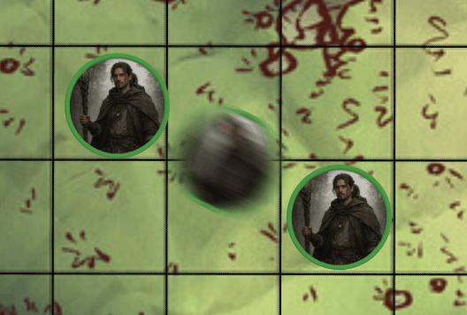
</a>

---

### Efectos Ambientales

Crea capas de color sobre el tablero para simular horas del día, clima o eventos astronómicos. El DM puede ajustar color, intensidad y modo de fusión para ambientar la escena.

- **Clima animado** - Lluvia, tormenta, nieve, niebla, nubes o brasas, con su intensidad. Se mueve con la cámara y solo cubre el mapa
- **Vista previa** - Muestra el color y el clima solo en tu pantalla antes de aplicarlos
- **Equipos lentos** - Cada usuario puede desactivar el clima animado en Configuración > Avanzado

<a id="ambient-fx">
 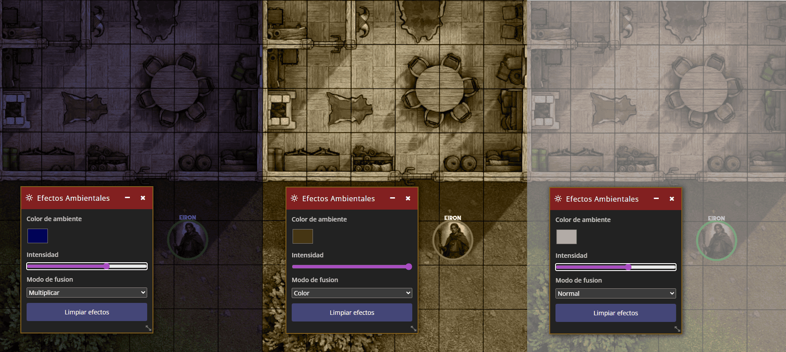
</a>

<a id="ambient-weather">
 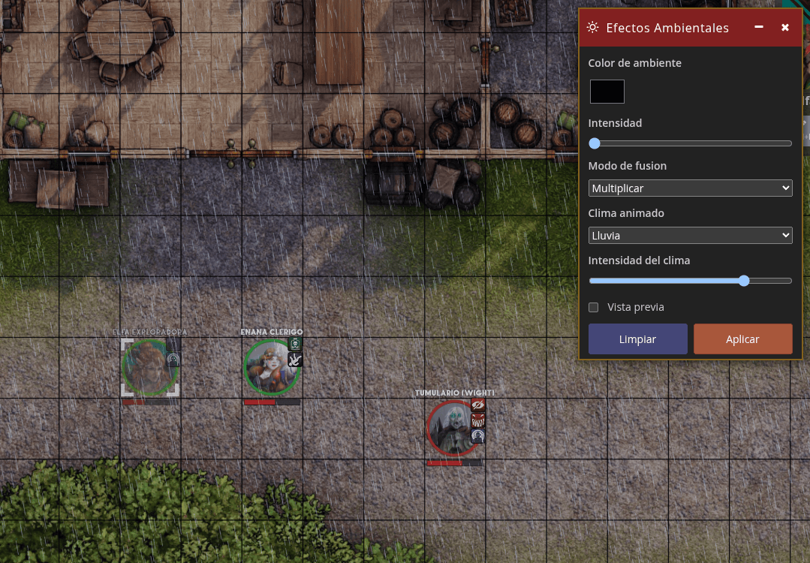
</a>

---

### Panel de Notas

Abre un panel flotante para tomar notas durante la partida. Las notas se guardan automáticamente en el navegador y persisten entre sesiones.

<a id="notes-panel">
 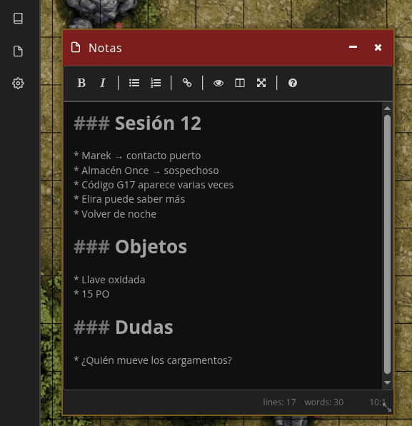
</a>

---

### Pantalla de DM

Abre una ventana flotante con tarjetas de referencia rápida para el DM, sin salir del tablero. Incluye un set de reglas de D&D predefinidas (Establecer una CD, Cobertura, Severidad del daño, CA y PG de objetos, Saltos, Acciones en combate) y soporta contenido en Markdown.

- **Solo DM** - El panel solo está disponible para el game master
- **Tarjetas personalizadas** - Crea tus propias tarjetas con título y contenido en Markdown
- **Editar/Eliminar** - Pasa el cursor sobre una tarjeta para editarla o borrarla
- **Reordenar** - Arrastra y suelta las tarjetas para cambiar su orden
- **Restaurar tarjetas** - Vuelve a las tarjetas predeterminadas en cualquier momento

<a id="dm-screen">
 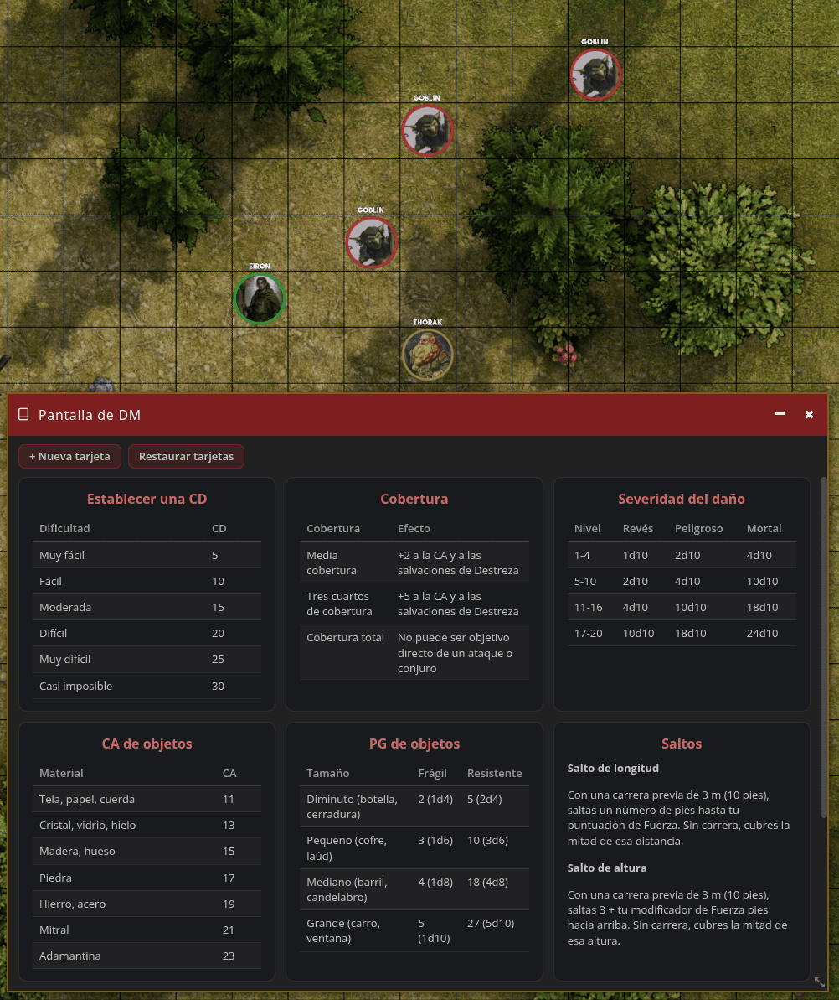
</a>

---

### Panel de Configuración

Centraliza todas las configuraciones de Nivel21 en un panel de ajustes.

**Mensajes al chat:** la primera vez que una acción va a enviar algo al chat (anunciar un conjuro, efectos ambientales, orden de turnos, ping, compartir contenido o notas de tokens) la extensión pregunta si enviarlo, con la opción «No volver a preguntar». En el clima, los turnos y el ping el mensaje es lo que sincroniza con los jugadores: si no se envía, el cambio no se aplica. La elección se puede cambiar en la pestaña **Chat** de la configuración.

<a id="settings-panel">
 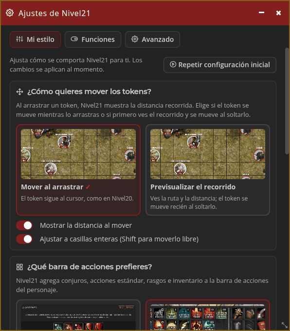
</a>

---

### Informe de Errores

Muestra un informe de errores cuando alguna función no se carga correctamente para que puedas copiarlo y compartirlo con nosotros. Esto nos ayuda a identificar y solucionar problemas de compatibilidad con futuras actualizaciones de Nivel20.

<a id="error-report">
 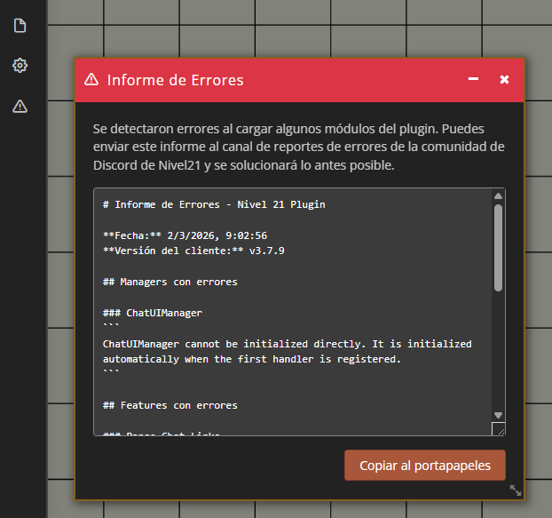
</a>

---

### Carpetas anidadas

Nivel20 aún no soporta carpetas dentro de carpetas de forma nativa. Organiza acciones en carpetas usando el separador " > " en el nombre. La barra se convierte en carpetas anidadas automáticamente.

Ejemplo:

- Crea un item llamado "Ataques > Espadas > Estocada"
- Si quieres elegir un icono en la carpeta "Espadas", crea una acción "Carpeta" o "Sin acción" con nombre "Espadas" y selecciona el icono deseado.

<a id="multi-level-action-bar">
 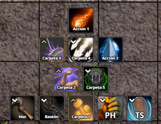
</a>

---

### Conjuros en la barra de acciones

Agrega automáticamente los conjuros de un personaje a su barra de acciones, con una carpeta por nivel de conjuro (Trucos, Nivel 1, Nivel 2…). Cada conjuro incluye las tiradas que correspondan, detectadas a partir de sus datos.

- **Tiradas según el conjuro** - Ataque (con ventaja/desventaja), daño, crítico, curación o dado de utilidad

- **Lanzar** - Los conjuros con tirada de ataque se lanzan con sus botones de ataque; los demás con daño o salvación tienen primero un botón «Lanzar» (con el icono del conjuro) que avisa en el chat, y los conjuros sin tiradas se lanzan con su propio botón. Si el conjuro es de concentración, al lanzarlo o al usar sus botones de ataque se le pone el estado Concentración al personaje. Lanzar un conjuro de nivel gasta un espacio de ese nivel (o uno de pacto)
- Las carpetas se llaman «Conjuros de nivel N» y muestran el nivel en número romano
- Los conjuros de un nivel sin espacios disponibles se ven en blanco y negro (se pueden lanzar igual)

<a id="spell-action-bar">
 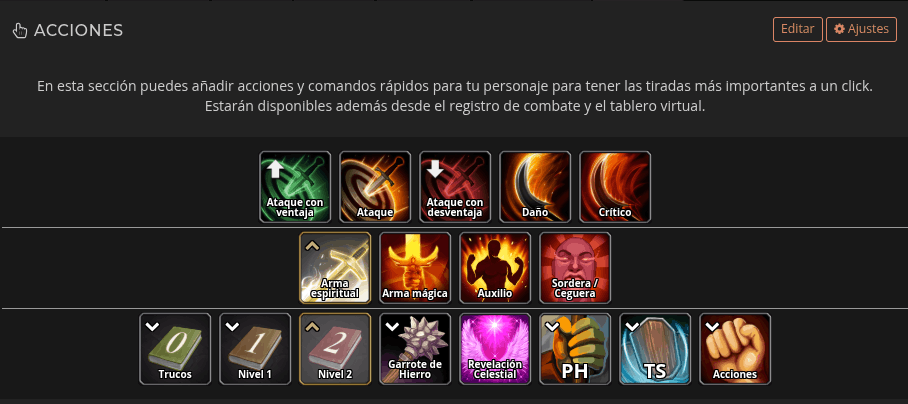
</a>

---

### Acciones estándar en la barra de acciones

Agrega automáticamente una carpeta "Acciones" al final de la barra de un personaje, con las acciones comunes de combate (Carrera, Destrabar, Esquivar, Ayudar, Ocultarse, Preparar, Buscar, Investigar y Usar), y una tirada de "Iniciativa" al principio (la misma que "Inic." del registro de combate).

<a id="actions-bar">
 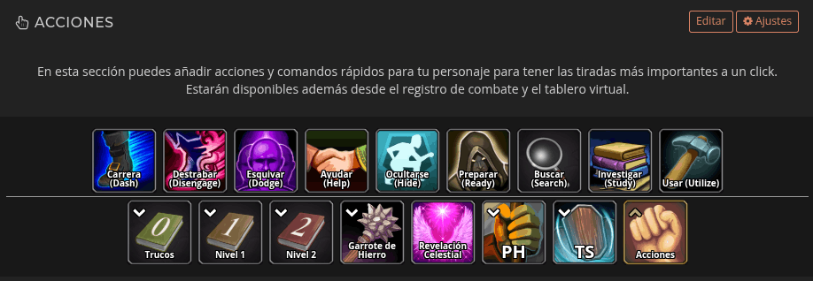
</a>

---

### Rasgos en la barra de acciones

Agrega automáticamente una carpeta "Rasgos" al final de la barra de un personaje, agrupando sus rasgos de clase, raza y dotes. Al hacer clic en uno se abre su detalle en un panel flotante, se pueden enviar al chat presionando Shift + clic.

<a id="traits-action-bar">
 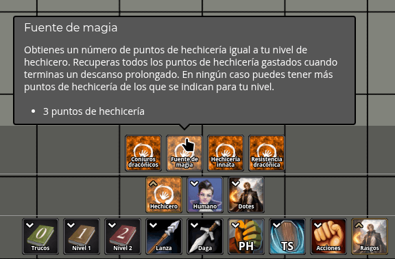
</a>

---

### Inventario en la barra de acciones

Agrega un botón "Inventario" al final de la barra de un personaje que abre un panel flotante con sus objetos (armas, armaduras y equipo) en una grilla, con el dinero calculado en la parte inferior.

- **Botón de refrescar** - Vuelve a descargar la hoja del personaje (limitado a una vez cada 10 segundos para no saturar el servidor)
- **Botón de editar** - Abre el equipo en la hoja del personaje
- **Cantidad** - Cada objeto muestra su cantidad sobre el icono
- **Reordenar** - Arrastra los objetos para ordenarlos (el orden se guarda en tu navegador, por personaje)
- **Click derecho en un objeto** - Usar uno (−1), Añadir uno (+1) o Eliminar objeto
- **Click derecho en el dinero** - Editar las monedas
- **Personajes ajenos** - Si no puedes editar ese personaje en Nivel20, el inventario es solo de lectura

Los cambios usan los mismos formularios que la hoja del personaje. La cantidad se guarda como `[qty:N]` al final de la descripción del objeto (nunca se borra texto: si no hay espacio, no se guarda).

<a id="inventory-panel">
 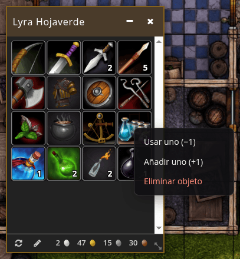
</a>

---

### Editor de monedas en el equipo

Escribe tu dinero con la etiqueta `[money:1pp 2gp 3sp]` en el campo "Otras posesiones". En la vista del equipo la etiqueta se muestra con los iconos de cada moneda en lugar del texto crudo.

- **Campos por moneda** - Al editar "Otras posesiones" se agrega, debajo del editor, un campo por moneda que actualiza la etiqueta automáticamente (solo se incluyen las monedas distintas de 0)

<a id="money-editor">
 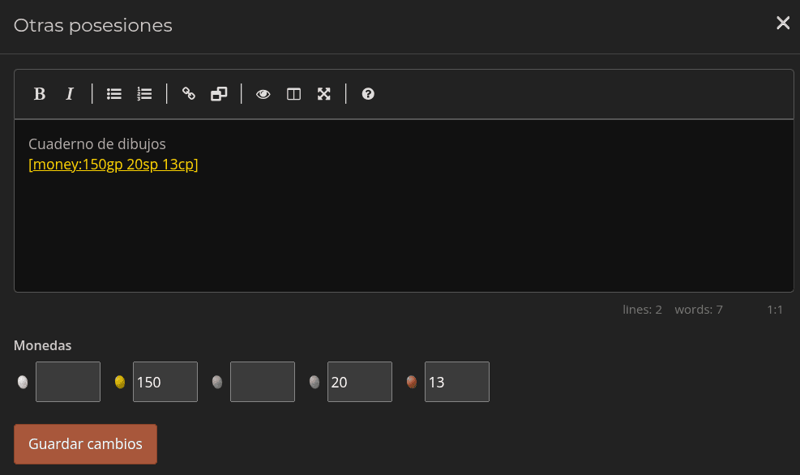
</a>

---

### Enviar tokens al chat

Permite agregar notas descriptivas a los tokens que se pueden compartir con los jugadores. Los DMs pueden hacer clic derecho en un token para ver o enviar sus notas al chat.

- **Click derecho en token (DM)** - Ver/enviar notas del token
- **Notas visibles** - Se muestran con formato enriquecido en el chat

<a id="token-notes">
 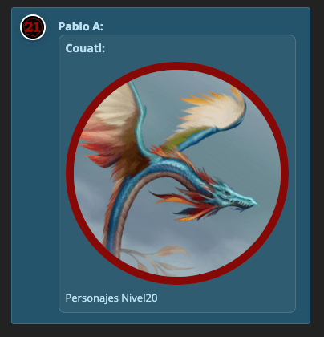
</a>

---

### Utilidades de cámara

Herramientas para los DMs que permiten controlar la cámara del mapa mediante el menú contextual.

- **Centrar cámara a todos** - Centra rápidamente la cámara de todos los jugadores en cualquier punto del mapa
- **Enderezar cámara** - Restablece la rotación de la cámara a 0 grados para una vista ortogonal perfecta

- **Enderezar cámara** solo aparece en el menú cuando la cámara está girada
- **Bloquear rotación** - Botón con candado en el menú rápido (junto a «Mostrar/Ocultar distancia») que evita girar la cámara por accidente; desplazar y hacer zoom siguen funcionando. Activado por defecto

<a id="camera-utilities">
 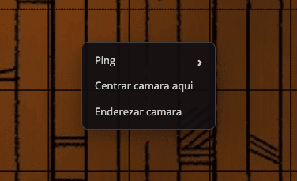
</a>

---

### Ping en el Mapa

Sistema de marcadores visuales animados para señalar ubicaciones en el mapa. Soporta múltiples presets con iconos animados y colores personalizados.

- **Click derecho en mapa** - Menú de ping
- **Doble click de la ruedita o tecla F** - Ping rápido donde apunta el cursor (la F solo funciona con el cursor sobre el tablero y sin escribir en ningún campo)
- **Comando manual** - `/ping x z [color] [icon]`

<a id="ping-map">
 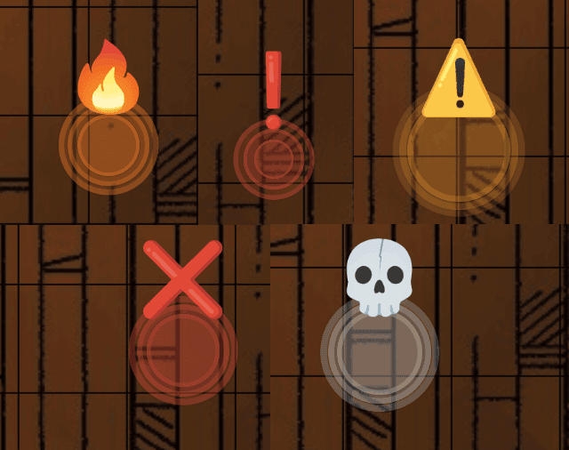
</a>

---

### Efectos en el Tablero

Panel para lanzar efectos animados sobre el tablero (aliento de dragón, rayos, proyectiles, explosiones...). Lo pueden usar el DM y los jugadores, y todos los que tienen la extensión lo ven en su mapa.

- **Botón de rayo en la barra derecha** - Abre el panel de efectos
- **Tipo de efecto** - La forma: Aliento, Haz y Cohete (se apuntan arrastrando desde el origen hasta el objetivo) o Explosión, Nova, Quemar, Brillo, Burbujeo y Salpicadura (un clic en el tablero)
- **Color** - Fuego, Encanto, Ácido, Muerte, Sagrada, Sangre, Escarcha, Limo, Humo, Agua o Magia; cada uno es una gama de colores
- **Esc** - Deja de lanzar el efecto elegido
- **Comando manual** - `/efecto tipo color x z [x2 z2]`

<a id="effects-panel">
 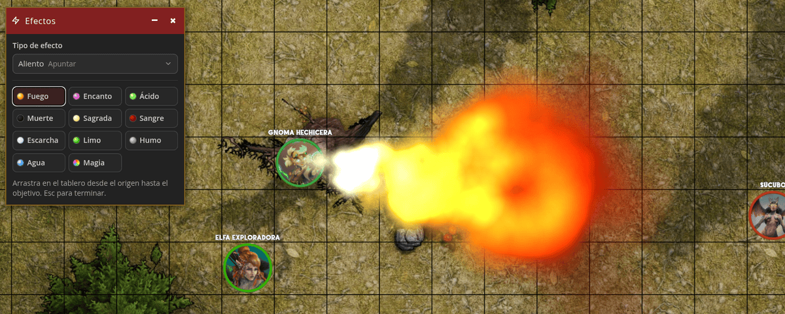
</a>

---

## Comunidad y Soporte

Este proyecto se desarrolla en conjunto con la comunidad.

Si tienes ideas, sugerencias o encuentras un error, únete a nuestro [servidor de Discord](https://discord.gg/KRHJm8x6rp).  
Ahí discutimos nuevas features, compartimos avances y damos soporte.

## Contribuciones

Las contribuciones son bienvenidas. Si encuentras un bug o tienes una sugerencia de mejora, siéntete libre de enviar un pull request.

## Apoya el Proyecto

Si te ha sido útil esta extensión, considera apoyar el proyecto:

